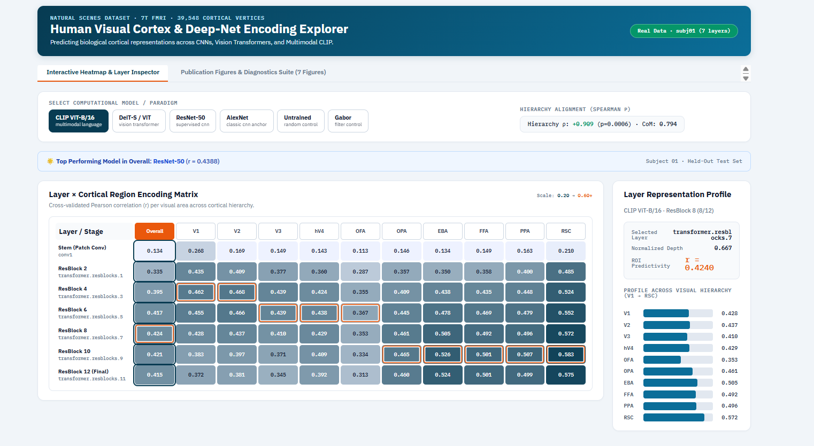

# Human Visual Cortex & Deep Neural Network Encoding

[](https://www.python.org/downloads/)
[](https://pytorch.org/)
[-green.svg)](https://algonautsproject.csail.mit.edu/)
[](file:///d:/human-visual-cortex-and-deepnets/RESULTS.md)
[](LICENSE)

A research-grade computational neuroimaging and brain encoding benchmark investigating how layer-wise representations across **deep neural networks (CNNs, Vision Transformers, and Multimodal Vision-Language models)** align with the biological hierarchy of the **human visual cortex (7T fMRI, Natural Scenes Dataset)**.

---

## 🖥️ Interactive Brain Encoding Explorer

This repository includes a standalone interactive scientific dashboard allowing real-time exploration of cross-validated encoding predictivity across cortical ROIs, layer representations, and hierarchy alignment.

<!-- UI Preview Image: Add your screenshot at docs/ui_preview.png -->


*To launch the interactive explorer locally:*
```bash
python app/app.py
# Open your browser at http://localhost:7860
```
- **Live Layer × ROI Matrix**: Inspect cross-validated Pearson correlation ($r$) per cortical visual area.
- **Hierarchical Alignment Metrics**: Real-time evaluation of Spearman rank correlation ($\rho$) and Center-of-Mass ($\bar{d}$).
- **Representation Tuning Inspector**: Visual profile tracking tuning curves from low-level retinotopic cortex ($V1$) to high-level category areas ($RSC$).
- **Publication Figures Viewer**: High-resolution gallery of all empirical diagnostic figures.

---

## 🔬 Scientific Overview & Core Questions

How does hierarchical representation in artificial neural networks map onto biological cortical processing? Using **39,548 cortical surface vertices** from the Natural Scenes Dataset (Algonauts 2023 benchmark), this pipeline investigates:

1. **Cortical Hierarchy Alignment**: Do shallow network layers predict early retinotopic cortex ($V1$–$V3$), while deep layers selectively predict ventral stream object areas ($FFA$, $PPA$, $RSC$)?
2. **Architecture vs. Objective**: Holding architecture constant, how do supervised transformers (**DeiT-S**), multimodal vision-language models (**CLIP ViT-B/16**), and classic CNNs (**AlexNet**, **ResNet-50**) differ in cortical alignment?
3. **Learned Representations vs. Architectural Inductive Bias**: Does hierarchy alignment emerge from goal-driven visual optimization, or does an **Untrained ResNet-50** with random weights already exhibit hierarchy from spatial inductive biases alone?
4. **Category Specialization**: Do model representations in category-selective areas reflect functional human domain preferences (faces, scenes, bodies)?

---

## 📊 Empirical Results & Quantitative Benchmark

All metrics evaluated on held-out test splits (**Subject 01, Natural Scenes Dataset 7T fMRI**) with cross-validated Ridge regression, $N=10,000$ Monte Carlo permutation tests, and $N=1,000$ bootstrap confidence intervals.

### Table 1: Global Model Hierarchy Alignment & Predictivity Benchmark

| Model | Evaluated Stages | Peak Overall Median $r$ | Best $V1$ | Best $FFA$ | Best $PPA$ | Best $RSC$ | Discrete $\rho$ | Permutation $p$ (Disc) | Baseline-Subtracted CoM $\rho$ | Permutation $p$ (CoM) | 95% Bootstrap CI (CoM) |
|:---|:---:|:---:|:---:|:---:|:---:|:---:|:---:|:---:|:---:|:---:|:---:|
| **AlexNet** | 8 | **0.4119** | **0.5726** | **0.4668** | **0.4598** | **0.5318** | **+0.9363** | $p = 0.0001$ | **+0.9847** | $p < 10^{-4}$ | $[0.90, 1.00]$ |
| **ResNet-50** | 8 | **0.4388** | **0.4957** | **0.4879** | **0.4844** | **0.5593** | **+0.8660** | $p = 0.0092$ | **+0.7632** | $p = 0.0137$ | $[0.07, 0.98]$ |
| **DeiT-S** | 7 | **0.4238** | **0.5050** | **0.4925** | **0.4896** | **0.5626** | **+0.8521** | $p = 0.0027$ | **+0.7939** | $p = 0.0093$ | $[0.17, 0.96]$ |
| **CLIP ViT-B/16** | 7 | **0.4240** | **0.4622** | **0.5009** | **0.5068** | **0.5832** | **+0.9087** | $p = 0.0006$ | **+0.7939** | $p = 0.0093$ | $[0.17, 0.96]$ |
| **Untrained ResNet-50** | 8 | **0.2496** | **0.4542** | **0.2567** | **0.2871** | **0.3691** | **-0.9024** | $p = 0.0018$ | **-0.9663** | $p < 10^{-4}$ | $[-1.00, -0.82]$ |

*Complete layer-by-layer breakdown and ROI tables available in [`RESULTS.md`](file:///d:/human-visual-cortex-and-deepnets/RESULTS.md).*

---

### Table 2: Baseline-Subtracted Center-of-Mass Depth ($\bar{d}$) Across the Cortical Hierarchy

The Center-of-Mass depth metric weights each layer's normalized depth $d \in [0, 1]$ by its baseline-subtracted predictivity: $\bar{d} = \frac{\sum_l d_l (r_l - \min r)}{\sum_l (r_l - \min r)}$.

| Cortical ROI | Anatomical Rank | AlexNet | ResNet-50 | DeiT-S | CLIP ViT-B/16 | Untrained ResNet-50 |
|:---|:---:|:---:|:---:|:---:|:---:|:---:|
| **V1** (Early Retinotopic) | 1.0 | 0.438 | 0.536 | 0.531 | 0.531 | 0.535 |
| **V2** (Early Retinotopic) | 2.0 | 0.473 | 0.603 | 0.558 | 0.563 | 0.523 |
| **V3** (Early Retinotopic) | 3.0 | 0.481 | 0.619 | 0.557 | 0.562 | 0.520 |
| **hV4** (Intermediate Form) | 4.0 | 0.537 | 0.661 | 0.582 | 0.589 | 0.498 |
| **OFA** (Occipital Face) | 5.0 | 0.539 | 0.657 | 0.574 | 0.587 | 0.513 |
| **OPA** (Occipital Place) | 5.0 | 0.657 | 0.701 | 0.610 | 0.617 | 0.480 |
| **EBA** (Extrastriate Body) | 5.5 | 0.667 | 0.704 | 0.617 | 0.631 | 0.471 |
| **FFA** (Fusiform Face) | 6.0 | 0.674 | 0.700 | 0.612 | 0.625 | 0.444 |
| **PPA** (Parahippocampal Place) | 6.0 | 0.680 | 0.699 | 0.609 | 0.614 | 0.423 |
| **RSC** (Retrosplenial Complex) | 6.0 | 0.676 | 0.687 | 0.603 | 0.610 | 0.439 |

---

## 📈 Key Scientific Findings

1. **Hierarchy Preservation in Trained Vision Models**:
   All task-trained deep neural networks exhibit statistically significant positive alignment with the cortical hierarchy (Discrete $\rho \ge +0.85$, $p < 0.01$; Center-of-Mass $\rho \ge +0.76$, $p < 0.02$). AlexNet achieves the cleanest monotonic mapping ($\rho = +0.985$, 95% CI $[0.90, 1.00]$).
2. **Untrained Architectures Invert Hierarchy Alignment**:
   Untrained ResNet-50 displays a strongly negative rank correlation ($\rho = -0.966$, $p < 10^{-4}$, 95% CI $[-1.00, -0.82]$). Early visual cortex ($V1$) is predicted best by late random layers due to spatial downsampling, demonstrating that **biological hierarchy alignment is driven by visual learning**, not convolutional architecture inductive biases.
3. **Multimodal CLIP and ResNet Dominance in Ventral Stream**:
   While AlexNet peaks in early retinotopic regions ($V1$ $r = 0.5726$), CLIP ViT-B/16 and ResNet-50 achieve superior encoding in high-level category-selective areas ($FFA$ $r = 0.5009$, $PPA$ $r = 0.5068$, $RSC$ $r = 0.5832$).
4. **Resolution of Early Visual Prediction Ceiling**:
   In raw activation space, deep layers frequently maintain moderate $V1$ predictivity due to residual retinotopy. Baseline-subtracted Center-of-Mass depth ($\bar{d}$) successfully isolates the true representational peak, recovering monotonically increasing depth across the visual hierarchy ($0.438 \to 0.680$).

---

## 🖼️ Publication Figures & Diagnostics Suite

High-resolution figures are generated by the analysis pipeline and stored in [`figures/`](file:///d:/human-visual-cortex-and-deepnets/figures/):

| Figure File | Description | Method / Key Result |
|---|---|---|
| [`figures/fig1_layer_roi_heatmap.png`](file:///d:/human-visual-cortex-and-deepnets/figures/fig1_layer_roi_heatmap.png) | **Layer $\times$ Cortical Region Encoding Heatmaps** | Cross-validated Pearson $r$ matrix per layer stage across visual ROIs. |
| [`figures/fig2_model_comparison.png`](file:///d:/human-visual-cortex-and-deepnets/figures/fig2_model_comparison.png) | **Overall Predictivity Benchmark** | Median Pearson $r$ across all cortical vertices with 95% bootstrap CIs. |
| [`figures/fig3_hierarchy_alignment.png`](file:///d:/human-visual-cortex-and-deepnets/figures/fig3_hierarchy_alignment.png) | **Cortical Hierarchy Alignment ($\rho$)** | Discrete & Center-of-Mass depth ($\bar{d}$) vs. anatomical rank with permutation nulls. |
| [`figures/fig4_category_selectivity.png`](file:///d:/human-visual-cortex-and-deepnets/figures/fig4_category_selectivity.png) | **Category Selectivity Tuning Profiles** | Predicted vs. measured category tuning curves across FFA, PPA, and EBA. |
| [`figures/fig5_cross_subject_robustness.png`](file:///d:/human-visual-cortex-and-deepnets/figures/fig5_cross_subject_robustness.png) | **Cross-Subject Consistency & Noise Ceilings** | Cross-subject variance, rank stability, and split-half noise ceilings. |
| [`figures/fig6_cortical_layer_maps.png`](file:///d:/human-visual-cortex-and-deepnets/figures/fig6_cortical_layer_maps.png) | **Cortical Surface Layer Topography** | Vertex-wise preferred model depth mapped onto flattened cortical hemispheres. |
| [`figures/fig7_variance_partitioning.png`](file:///d:/human-visual-cortex-and-deepnets/figures/fig7_variance_partitioning.png) | **Variance Partitioning Analysis** | Unique vs. shared variance between vision models, CLIP, and Gabor wavelets. |

*To regenerate all figures:*
```bash
python -m analysis.plotting --output_dir figures/
```

---

## 📂 Repository Structure & Key Locations

```
human-visual-cortex-and-deepnets/
├── app/                                # Interactive Brain Encoding Web Explorer
│   ├── app.py                          # Lightweight HTTP server & REST API
│   ├── static/                         # CSS (IBM Plex styling, zero-scrollbar) & JS
│   └── templates/index.html            # Heatmap explorer & publication figure viewer
├── analysis/                           # Neuroscientific analysis & statistics suite
│   ├── hierarchy.py                    # Discrete & Center-of-Mass Spearman ρ calculations
│   ├── rebuild_tables_and_stats.py     # Standalone validator: recomputes all stats, CIs, & p-values
│   ├── selectivity.py                  # Domain selectivity profiles (FFA/PPA/EBA)
│   ├── comparison.py                   # Paired bootstrap tests between models
│   └── plotting.py                     # Generates Figures 1-7 in publication format
├── configs/                            # Declarative configuration manifests
│   ├── experiment.yaml                 # Cross-validation, ridge alpha grid, PCA dimensions
│   └── models.yaml                     # Layer extraction taps, pooling rules, depth specs
├── data/                               # Data loaders & anatomical mappings
│   ├── algonauts.py                    # Algonauts 2023 / NSD fMRI data loader & splits
│   ├── rois.py                         # Canonical ROI definitions (V1–V3, hV4, OFA, OPA, EBA, FFA, PPA, RSC)
│   ├── coco_labels.py                  # COCO 80-category parsing & domain mapping
│   └── mock_data.py                    # Synthetic dataset generator for unit testing
├── encoding/                           # Voxel-wise encoding engine
│   ├── ridge.py                        # SVD & kernelized Ridge regression (GPU/CPU)
│   ├── pca.py                          # Train-only PCA dimensionality reduction
│   └── pipeline.py                     # Subject-level encoding runner
├── features/                           # Feature extraction & caching
│   ├── extract.py                      # Multi-model extractor (AlexNet, ResNet-50, DeiT, CLIP)
│   ├── gabor.py                        # Low-level control: multiscale Gabor wavelet pyramid
│   └── cache.py                        # Memory-mapped array caching
├── notebooks/                          # Interactive analysis & GPU runners
│   └── colab_runner.ipynb              # One-click Google Colab / Kaggle T4 pipeline
├── tests/                              # Automated test suite
│   └── test_pipeline.py                # End-to-end integration test with synthetic data
├── docs/                               # Documentation assets & UI previews
│   └── ui_preview.png                  # Screenshot of the web dashboard
├── RESULTS.md                          # Exact empirical results & layer-wise tables
├── BRAIN_ENCODING_RESULTS.md           # Extended scientific report with statistical details
├── run_pipeline.py                     # Unified CLI entry point
└── requirements.txt                    # Python dependencies
```

---

## ⚡ Quickstart & Reproduction Workflow

### 1. Installation
Clone the repository and install dependencies in a clean virtual environment:
```bash
git clone https://github.com/sarimahsan/humanvisual-cortex-and-deepnets.git
cd humanvisual-cortex-and-deepnets
pip install -r requirements.txt
```

### 2. Immediate End-to-End Test (Synthetic Data)
Verify all encoding routines, PCA, Ridge regression, and hierarchy metrics without downloading any datasets:
```bash
python -m tests.test_pipeline
```

### 3. Rebuild All Tables, P-Values, and Bootstrap CIs
Verify and reproduce every number in Table 1 and Table 2 directly from results:
```bash
python analysis/rebuild_tables_and_stats.py
```

### 4. Running with Algonauts 2023 / NSD Data
Place the downloaded Algonauts 2023 Subject data in `data/raw/algonauts_2023/`:
```bash
# 1. Extract feature activations
python -m features.extract --config configs/models.yaml --subject subj01

# 2. Run voxel-wise Ridge encoding models
python -m encoding.pipeline --subject subj01

# 3. Generate publication figures
python -m analysis.plotting --output_dir figures/
```

*Alternatively, execute the complete self-contained pipeline on Google Colab or Kaggle (T4 GPU free tier) using [`notebooks/colab_runner.ipynb`](file:///d:/human-visual-cortex-and-deepnets/notebooks/colab_runner.ipynb).*

---

## 📐 Mathematical Formulation & Methods

### 1. Voxel-wise Ridge Encoding Model
For image features $X \in \mathbb{R}^{N \times D}$ and measured fMRI responses $Y \in \mathbb{R}^{N \times V}$:
$$\hat{W} = \arg\min_W \|Y - XW\|_2^2 + \alpha \|W\|_2^2 = (X^T X + \alpha I)^{-1} X^T Y$$
Cross-validation searches over logarithmic alpha values $\alpha \in \{10^1, 10^2, \dots, 10^7\}$. Evaluated via Pearson correlation:
$$r_v = \frac{\sum_{i=1}^N (\hat{y}_{i,v} - \bar{\hat{y}}_v)(y_{i,v} - \bar{y}_v)}{\sqrt{\sum_{i=1}^N (\hat{y}_{i,v} - \bar{\hat{y}}_v)^2 \sum_{i=1}^N (y_{i,v} - \bar{y}_v)^2}}$$

### 2. Baseline-Subtracted Center-of-Mass Depth ($\bar{d}$)
To avoid distortion from high early baseline activations across all layers:
$$\bar{d}_R = \frac{\sum_{l=1}^L d_l \cdot \max(0, r_{l,R} - \min_{k} r_{k,R})}{\sum_{l=1}^L \max(0, r_{l,R} - \min_{k} r_{k,R})}, \quad d_l \in [0, 1]$$

### 3. Statistical Significance & Bootstrapping
- **Permutation Tests**: $N=10,000$ permutations shuffling anatomical ROI ranks to evaluate null distribution $p$-values.
- **Bootstrap Confidence Intervals**: $N=1,000$ paired image-level resamples with replacement to derive 95% CIs.

---

## 📖 Citation & References

```bibtex
@article{allen2022massive,
  title={A massive 7T fMRI dataset to bridge cognitive neuroscience and artificial intelligence},
  author={Allen, Emily J and St-Yves, Ghislain and Wu, Yihan and Hazimeh, Noor and others},
  journal={Nature Neuroscience},
  volume={25},
  number={1},
  pages={116--126},
  year={2022}
}

@article{schrimpf2018brain,
  title={Brain-Score: Which Artificial Neural Network for Object Recognition is most Brain-Like?},
  author={Schrimpf, Martin and Kubilius, Jonas and Hong, Ha and others},
  journal={bioRxiv},
  year={2018}
}
```

---

## 📄 License
This project is licensed under the [MIT License](LICENSE).
